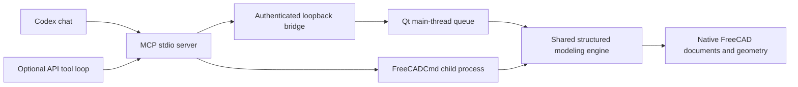

# Architecture

`server.py` owns the model-facing tools and typed Pydantic operation schemas. A backend is chosen when the server starts. Synchronous SDK tool handlers run outside the MCP event loop. `client.py` implements serialized background RPC and authenticated live HTTP requests. It explicitly bypasses environment HTTP proxies for loopback requests.

`engine.py` uses only standard-library modules plus FreeCAD modules imported inside the native interpreter. Host Python never imports FreeCAD's binary modules. `worker.py` is imported as a script by FreeCADCmd and stays in a request loop on its main thread. A unique response prefix separates RPC JSON from native console messages. The host drains stdout/stderr separately and correlates response IDs. Native configuration files and user settings are isolated per background worker.

`bridge.py` starts a loopback HTTP server inside FreeCAD and uses a bounded queue plus QTimer. HTTP threads authenticate and enqueue requests; only the GUI timer calls the modeling engine. Every document operation is serialized with FreeCAD's GUI event loop. A running geometry call is synchronous; expensive operations may temporarily block the window. A cancelled pending request is never executed. An operation that has already started cannot be safely interrupted at arbitrary native kernel instructions.

`apply_operations` validates the allowed operation shape, opens a FreeCAD document transaction, executes dependent operations in order, recomputes, checks validity, then commits. On exception it aborts and recomputes. A view-refresh failure after commit is returned as a warning. Views are refreshed on the edited document. The operation transaction does not include independent filesystem writes. UI undo can target the same live transaction; the undo tool can also undo a recent manual transaction.

Revision hashes combine object names/types, inspectable properties and native shape hash codes. Native wrapper memory addresses are normalized. Tokens intentionally describe this session; they do not authenticate serialized file equality or form a complete dependency/version history.

The workspace resolver rejects traversal and resolved paths outside the configured root, including resolved symlinks. Existing writes require explicit overwrite and copy the existing bytes to a unique backup. This is ordinary path confinement, not a defense against a hostile process racing directory changes. Native FCStd restoration and add-on loading remain FreeCAD behaviors.

Imports use native Part readers for STEP/BREP and native Mesh readers for STL. They run inside the same edit transaction as other operations; source bytes are hashed before and after parsing. Import returns a static geometry snapshot and source metadata. Closed-mesh conversion also produces a static BREP snapshot. Native `Part::Fillet` and `Part::Chamfer` objects carry their base dependency and edge parameters without custom Python proxies. They therefore retain native recomputation and save/reopen behavior. Consumed input visibility is stored even in background-created FCStd files.

Topology inspection pages through the current shape's indexed subelements and reports geometry and measurements. Edge selections are resolved against the named base shape and checked for valid, unique indices before kernel work. Revision tokens guard stale edits; topology indices themselves are not durable identifiers. Minimum-distance calls use the native BREP distance solver. Meshes require explicit conversion before those BREP operations. Mesh vertex/connectivity bytes participate in document revision hashes.

The generated start macro stops the old GUI bridge, reloads the integration modules and creates a fresh bridge/token. Existing document features are native FreeCAD objects, so module reloading does not replace or close those documents. MCP server processes must be restarted separately to discover updated tool schemas.

`sketches.py` handles native geometry/constraint creation and readback. Rectangles expand into four native lines and, by default, fully constraining named dimensions. Arc creation uses a three-point native constructor. The helper is shared by creation and append operations within the engine's transaction. `inspect_sketch` reads local geometry and dimensional datum metadata without solving or changing the sketch. Geometric constraints have no driving/reference datum flag, so that field is null for them.

`patterns.py` creates compact native `App::Link` arrays (`ShowElement=false`) with evaluated placement lists and read-only parameter metadata. No Python feature proxy executes on recompute or file restore. Native linked geometry follows source dimensions. Source placement is sampled into document-space transforms, and dedicated pattern-update operations resample it while retaining the array object's own Placement. These controls are intentionally distinct from live expression-driven placement constraints. Partial circular spans include endpoints; full circles omit the duplicate final position. Instances remain separate shapes rather than a fused union.

Native array Shape access can construct a new compound, so its identity hash is unstable. Revision hashing serializes a mesh-free topology copy instead, and skips internal native properties. Geometry bounds use `optimalBoundingBox(false, false)` so display triangulations do not change measured extents. The BREP export path writes evaluated shape compounds directly because FreeCAD 1.0.2's object-dispatch exporter can silently ignore link arrays. Empty topology is rejected at import/export boundaries.

The Responses API example uses an in-process MCP client for schema discovery and validated tool dispatch. It does not expose the localhost bridge to OpenAI's remote MCP infrastructure. Cloud-hosted access would need a separate authenticated transport design; the current bridge is for the same computer only.
